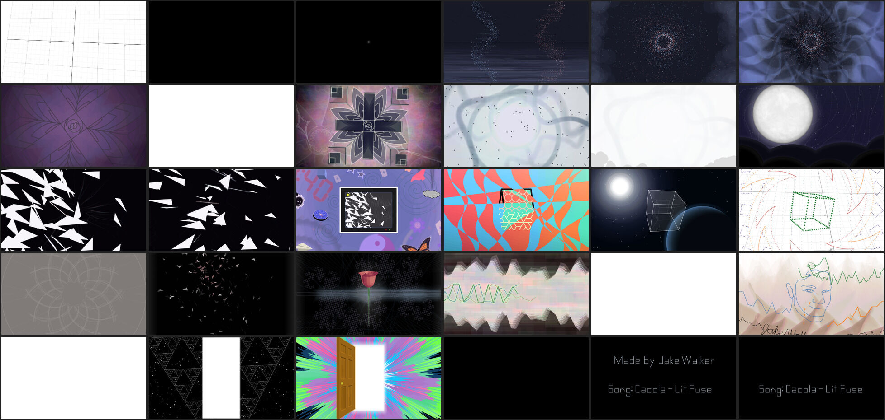

# Apotheosis (p6629mijkm), the cinematic one

1,517 items, 49 folders, ~25 scenes, synced to a song (Cacola, "Lit Fuse", 115 BPM). This is the closest thing to what we want to build: a music video made of many scenes inside one graph.

*Rows read left to right: scene clock a0..a9, each sampled at 2, 5 and 8. Rendered headless from desmos.com, 5 to 25 s per frame.*

## How time works

- **One master clock, ten scene clocks.** `a` runs from -10 to ~100. A ticker runs `A_nimA, a -> a + delta(dt)` every frame, with `delta(dt) = BPM/60 * dt/1000`. So `a` is measured **in beats**, not seconds, and every cut lands on the music.
- `A_nimA` is a piecewise action that routes `a` into ten local clocks `a_0..a_9`, each 0..10: `{a<0: a_0 -> mod(a,10), a<10: (a_0 -> 10, a_1 -> mod(a,10)), ...}`. Finished scenes are pinned to 10.
- **Scene visibility** comes from `Toggle(a, x, y) = [1, {x<a<y: 2, 1}...3][1]`. Multiply any list or point by it: outside the window the result is undefined, so the whole expression disappears and costs almost nothing.
- Each scene is designed on 0..10, so scenes can be authored, previewed (drag one slider) and re-timed independently.
- **Built-in render mode.** `RENDER = a -> a + delta(1000/FPS), A_nimA` plus `FRAMESTORENDER = ceil(...)` and a `RESETALLFORRENDER` action. Stepping the action once per captured frame gives a frame-exact export, decoupled from how slowly the graph actually draws. This is exactly what our Playwright renderer should do.
- `L_owDetail` slider halves particle counts while authoring.

## Visual techniques seen

| Technique | Expression shape |
|---|---|
| Pixel-relative widths | `l = width/1206`, then `lineWidth = 5l` everywhere |
| Perspective 3D | `d(p) = 15 (p.x, p.y)/p.z {p.z>0}` plus a full `R_3(p, θx, θy, θz)` rotation |
| Bezier helpers | `b_3`, `b_4`, `b_04(t, list)` |
| Keyframes | `K_ey(p, x)` linear interpolation over a list of (time, value) points |
| Easing | `median(0, 1, ...)`, `tanh`, logistic `1/(1+e^{-k(x-c)})` for every in/out |
| Flash cut | full-screen `polygon(50 S_q)` white with `fillOpacity = e^{-8(a_1-10)^2}` |
| Fade from white | same square with `fillOpacity = 1 - a_1` |
| Camera shake | `T_ornShake = amp(a_1) (sin 23a_1, cos 31a_1)` added to everything |
| Rain / particles | `random(1000, floor(100 a_1))`: re-seeding with a time step gives per-frame jitter |
| Depth fog | `polygon(...) for n = 0.1[1...30]^2` with `fillOpacity = 2/[1...30]` |
| Lake waves | hundreds of small polygons from one `for n=[1...200]` line, wrapped with `mod(x,24)-12` |
| Colour animation | `hsv(230, 0.4 - 0.1 flash, (1+2 flash) 0.15)` via `colorLatex` |
| Letterbox | `Canvas` folder: one polygon with a hole (outer 500 box joined to inner 20x15 box) |
| Pseudo-random hash | `h - floor(h) with h = sin(3748345.111 e^{x + [1...N]})` for cracks |

## Lessons for us

1. Measure time in beats when there is music. Store BPM once.
2. Author each scene on its own 0..10 clock and gate it with a Toggle so off-screen scenes cost nothing.
3. Export by stepping an action per frame, never by real-time playback.
4. A small shared helper library (rotation, 3D, Bezier, easing, keyframes, colours) is reused across every scene.
