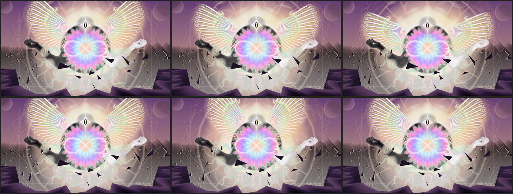

# Math: Final Boss (u6nxdjq31x), the polished still with idle motion

291 items, 19 folders, 51 author notes. The author documented almost every trick in text notes, so this is the best tutorial of the four. One slider `a` (0..1800, 26.7 s loop) drives subtle idle motion: wing flap, rune hover, rock sway.

## Structure

Folders read bottom to top as painter's layers: Basic Functions, Basic Colors, Planets and Stars, Cliffs Background, Rock Shards Background, Circle Design, Black Hole, Wings, Vinewaves, Arms, Flower Body, Eye, Symbol Runes, Rock Shards Foreground, Signature, Foreground Cliffs, Lens Flare and Canvas. Expression order is draw order.

## Techniques (from the author's own notes)

- **Gradients and glow by stacking.** Many copies of one shape, each a bit bigger, at very low opacity, in one line: `[polygon(50 S_q.x, n(S_q.y + 0.5) - 10) for n = [9, 9.2 ... 18]]` at `fillOpacity 0.025`.
- **Blur by scaled duplicates.** The background cliffs are drawn 11 times at scales `1 + 0.1n` and opacity 0.1.
- **Polygons over parametrics.** Circles become `polygon(c([0, 1/N ... 1]))`. The global `N` slider (20..150) trades smoothness for speed.
- **0/0 breaks.** A NaN inside a point list breaks the line, so many strokes live in one expression.
- **Crescent lighting.** A circle minus an offset circle via piecewise inequalities, stacked into a gradient.
- **`median(x, -6, 6)` as a clamp.**
- **Random scatter.** `Stars = (30(random(300) - 0.5), 8 random(300))` with per-star size `2 random(300) l`.
- **Shapes built from symbols.** Wing feathers are integral signs traced as Bezier tables, rotated with `R(p, θ)` and placed along Bezier "bones". Rings use joined lists of sizes and rotations.
- **Rim lighting.** Scale a shape slightly, join it with the original reversed, and you get a strip along the edge. A list of scales turns that strip into a gradient.
- **ImageMode for playback.** Heavy parts are pre-rendered to transparent PNGs (with Gifsmos V) and swapped in with `center = [(0,0)][I_mageMode]`. The expressions error out on purpose when `I = 1 - ImageMode` is 0. Good fallback when a scene is too slow to play live.
- **Pixel-relative widths** (`l = width/816`).

## Lessons for us

1. Layer order equals draw order. Keep one folder per layer.
2. Glow, blur, gradients, fog and bloom are all the same trick: a list of slightly different copies at low opacity. One helper can generate all of them.
3. Expose a quality knob (`N`, point counts) so authoring is fast and final renders are smooth.
4. Since we render offline, we can skip ImageMode, but it is the right answer for graphs people play live.
