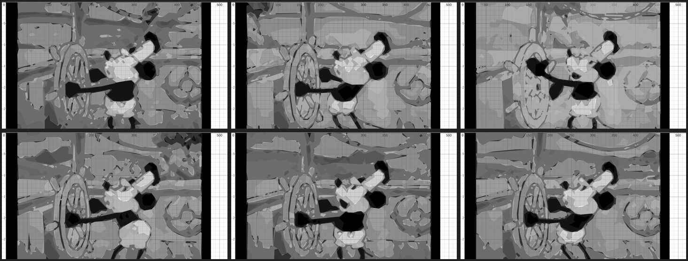

# Steamboat Willie, 96 frames (bhqh6a0i9g), video converted to polygons

392 items, 3 MB of LaTeX. Made by a converter script, not by hand. It plays live in Desmos at ~30 fps.

## How it works

- Every video frame is posterized to **four grey levels**. Each level becomes **one** `polygon(x-list, y-list)` expression where all the blobs of that level are joined with `0/0` separators (around 150 blobs and 1,800 points per layer).
- Four layers per frame, drawn as stacked fills: black at opacity 1, #282828 at 0.47, #6f6f6f at 0.34, #eaeaea at 0.32. Darker layers sit on top.
- 96 frames x 4 layers = 384 hidden definitions `a_0..a_95`, `b_..`, `c_..`, `d_..` in a folder called "don't open this folder" (opening it would make Desmos typeset 3 MB of LaTeX).
- Four visible expressions pick the current frame: `[a_0, a_1, ..., a_95][k]`.
- Playback: ticker `p = k -> {k = 96: 1, k + 1}` every 33.37 ms.

## Lessons for us

1. For image or video input, **filled posterized layers beat outline tracing**. You get shading, the result looks like art, and it stays playable.
2. One polygon per colour layer with NaN separators keeps the expression count tiny.
3. Indexing a list of frames with a counter `[f_1 ... f_n][k]` is the cheapest frame-by-frame animation in Desmos.
4. Hide heavy definitions in a collapsed folder.

Our image converter (next milestone) should copy this shape: quantize to K colours, trace each colour mask with potrace, sample the Bezier paths into points, emit one `polygon()` per colour.
