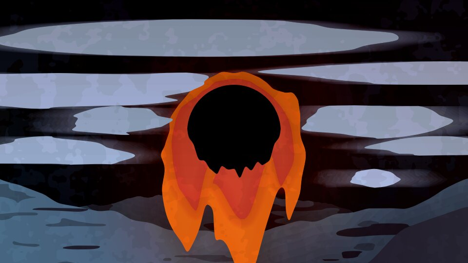
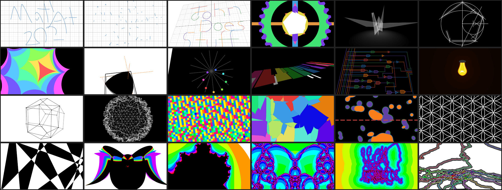

# Unveil (0njfwi6qhr), the "mid example with steps"

The linked graph is a 57-item still made for the Desmos Math Art Contest. Its notes link the real animation (exrsglggq0, 1,112 items, ~75 s, 24 scenes) and the author's process document. Together they show the whole workflow from idea to finished animation.

## The still: procedural landscape

- **Cosine value noise from a fixed random list.** `R_fixed` is ~5,000 pasted random numbers. `cosInt(x, R)` cosine-interpolates between list entries. `cosNoise(x, levels, offset)` gives 1D noise, `cosNoise2d` 2D, `cosNoise2dFrac` sums three octaves. Pasting the numbers (instead of `random()`) keeps the shapes stable across reloads.
- Mountains, clouds and a flame are closed parametric curves with noise added to the radius or height, filled with `fillOpacity 1`.
- **Soft cloud edges:** `2[-1, -0.9 ... 1] + 6 sin(2πt) ...` draws each cloud 21 times shifted sideways at opacity 0.05, a horizontal blur in one line.
- **Glow:** `(t, f(t) + 0·[1...10])` with `lineWidth 50·[1...10]` and `lineOpacity 0.02`. The `0·[1...10]` turns one curve into ten, and each copy takes the next line width.
- **Starfield and texture:** `cosNoise2dFrac(3x, 3y, 20, 0) > 0.875` shades the speckles.
- **Vignette and sky gradient:** `(x+6)^2 + (y+10)^2 > [9...20]^2` and `y > [-2, -1.5 ... 10]` at opacity 0.01.
- **Background:** `|x| > 0` fills the whole screen.
- Palette as named `hsv()` variables (`t_itleC0..7`), applied with `colorLatex`.

## The animated version: the timeline pattern

- One slider `anim` in seconds. Timestamps were planned against the music first, as a list like `0:05.356 draw meta functions for text...`.
- Each scene gets a master: `sceneMaster = (anim - t0)/(t1 - t0) {t0 <= anim < t1}`. Outside its window it is undefined, so the scene vanishes.
- Every movement is eased with a 1D cubic Bezier: `beizure(x, a, b, c, d)` with control values a..d, clamped to a below 0 and d above 1, plus `lerp`. `beizure(p, 0, 0, 1, 1)` is ease-in-out; `(p, 0, 1, 1, 1)` is ease-out.
- Event lists: `notesPressed = {anim >= noteTimes: noteNotes, -∞}` for the piano scene; linger with `notesStrength`.
- One `3D(point, angX, angY, dist)` function is the whole camera.
- `|11|` instead of `11` so a constant does not become a slider by accident.

## The process (from the author's doc)

1. Write the timeline (timestamps plus one line per beat).
2. Build every component in its **own graph** first: utilities (animation curves, gradients, rotate, 3D, lerp), each glyph, then each scene, often in several attempts.
3. Merge into the main graph by copying expression JSON in the console and re-keying the ids: `exp.forEach((e,i) => e.id = Date.now() + "a" + i); Calc.setExpressions(exp)`.

## Lessons for us

1. Plan the timeline first, then build scenes as separate files and merge. This maps directly onto a skill: one file per scene, a script that merges them and re-keys ids.
2. `sceneMaster` windows plus Bezier easing is a simple, complete animation system. Copy it.
3. Fixed noise tables beat `random()` when shapes must stay put.
