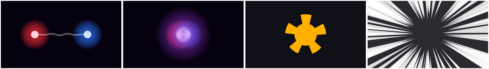
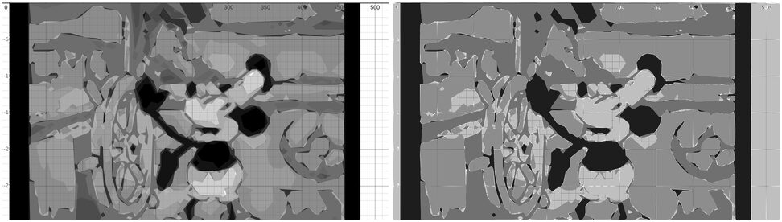

# Technique tests

`python3 gen.py` writes the scene files; render one with

```sh
NODE_PATH=$(npm root -g) node scripts/render.js research/tests/t2_glow.json out/t2
ffmpeg -framerate 30 -i out/t2_%04d.png -pix_fmt yuv420p t2.mp4
```

| Scene | What it proves | ms/frame |
|---|---|---|
| `t1_colors.json` | one expression can draw a list of shapes in a list of colours (`colorLatex` list) | ~100 |
| `t2_glow` | energy orbs: soft halos, glow strokes, re-seeded energy arcs, eased merge into a purple bloom | ~100 |
| `t3_morph` | shape tweening between two equal-length point lists | ~60 |
| `t4_particles_2000` / `_9000` | particle scaling with per-point size and colour | 125 / 240 |
| `t5_impact` | impact frame: random speed lines, white-out pulse, camera shake and zoom through the viewport | ~100 |
| converter | `scripts/img2desmos.py` on a 4-tone frame: 24k points | ~300 |




